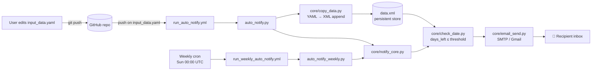

# AutoNotify

**Serverless expiry reminders for important documents, run entirely on GitHub Actions.**

AutoNotify tracks expiry dates for passports, licences, cards, insurance policies and similar documents. When anything is within 30 days of expiring, it sends an alert email. It needs no server, database or cron box. The repository holds the data, and GitHub Actions runs the schedule.

---

## Features

- **Declarative input**: list documents in `input_data.yaml` and push.
- **Two triggers**:
  - *On change*: editing `input_data.yaml` merges the new entries into the persistent store and runs a check immediately.
  - *Weekly*: a cron job runs every Sunday at 00:00 UTC and re-checks every stored document.
- **Threshold alerts**: anything expiring within `DAYS_THRESHOLD` (default **30 days**), or already expired, goes into one summary email.
- **Email over SMTP** (Gmail on port 587 with STARTTLS). Credentials come from GitHub Secrets, never from the code.
- **Lint gate**: every push runs Pylint.

---

## Architecture



| Module | Responsibility |
|---|---|
| `auto_notify.py` | Entry point for the on-change workflow. Appends YAML to XML, then runs the check. |
| `auto_notify_weekly.py` | Entry point for the scheduled workflow. Runs the check only. |
| `core/copy_data.py` | Parses `input_data.yaml` and appends each record as a `<person>` node to `data.xml`, pretty-printed. |
| `core/check_date.py` | Walks `data.xml` and collects every record whose `expire_date` is within the threshold. |
| `core/email_send.py` | Builds a MIME email listing the expiring items and sends it over SMTP. |
| `core/notify_core.py` | Orchestrates `check_expiry` → `send_expiry_alert_email`. |

---

## Getting started

1. **Fork** this repository.
2. Add these **repository secrets** (Settings → Secrets and variables → Actions):

   | Secret | Description |
   |---|---|
   | `SENDER_EMAIL` | Gmail address that sends the alerts |
   | `SENDER_PASSWORD` | A Gmail **App Password** (not your account password) |
   | `RECIPIENT_EMAIL` | Address that receives the alerts |

3. Edit `input_data.yaml` and push:

   ```yaml
   - name: "Passport"
     expire_date: "2027-12-31"
   - name: "Driver's License"
     expire_date: "2026-06-15"
   ```

   Dates must use the `YYYY-MM-DD` format. Extra keys are stored in `data.xml` as-is, and list values become repeated elements.

4. The **Run auto_notify.py** workflow runs automatically. After that, the weekly workflow keeps checking.

### Running locally

```bash
pip install pyyaml python-dotenv
cat > .env <<EOF
SENDER_EMAIL=you@gmail.com
SENDER_PASSWORD=your-app-password
RECIPIENT_EMAIL=you@example.com
EOF
python auto_notify.py          # merge YAML + check
python auto_notify_weekly.py   # check only
```

---

## Project structure

```
AutoNotify/
├── .github/workflows/
│   ├── pylint.yml                  # lint on every push
│   ├── run_auto_notify.yml         # trigger: input_data.yaml changed
│   └── run_weekly_auto_notify.yml  # trigger: weekly cron
├── core/
│   ├── check_date.py
│   ├── copy_data.py
│   ├── email_send.py
│   └── notify_core.py
├── auto_notify.py
├── auto_notify_weekly.py
├── input_data.yaml                 # your input
└── data.xml                        # accumulated document store
```

## Tech stack

Python 3.11 · PyYAML · `xml.etree` · `smtplib` · python-dotenv · GitHub Actions

## License

See [LICENSE](LICENSE).
